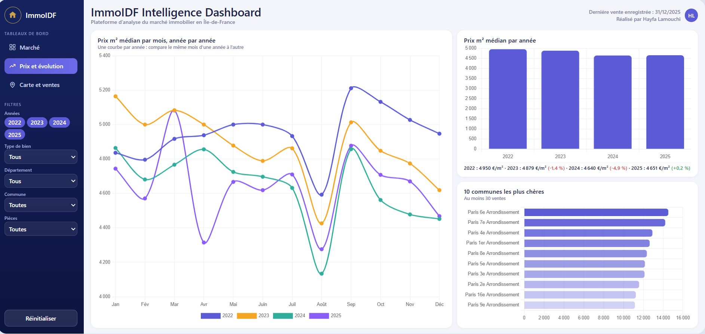
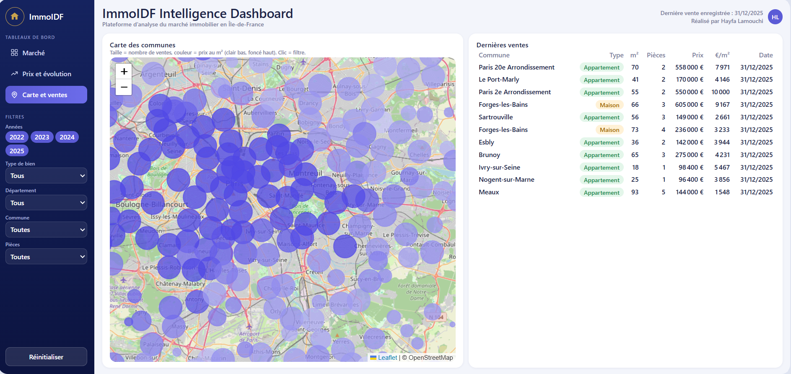
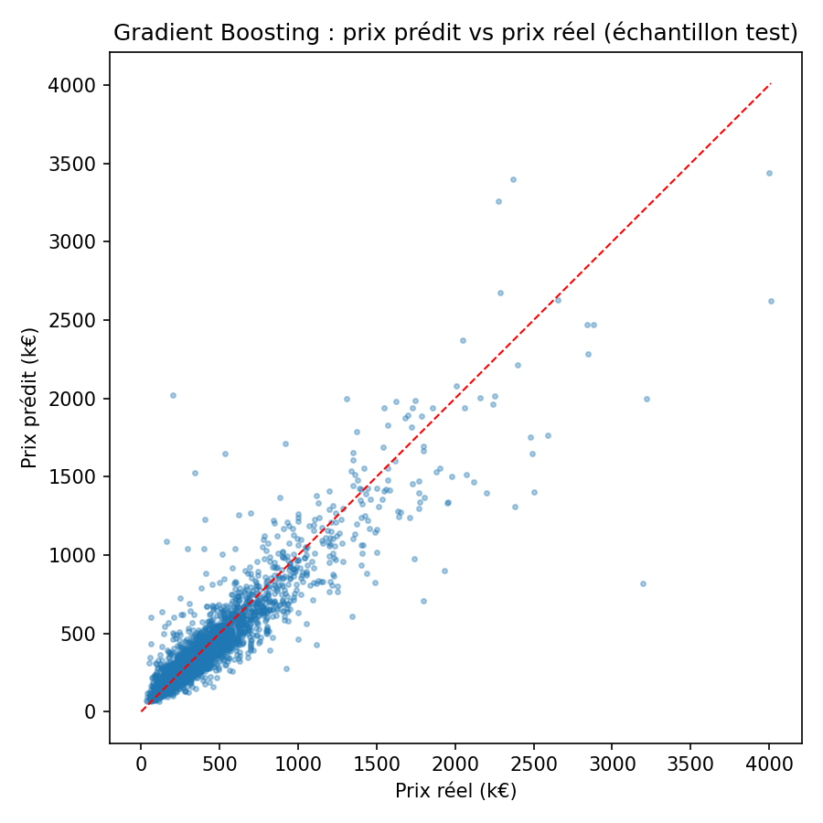
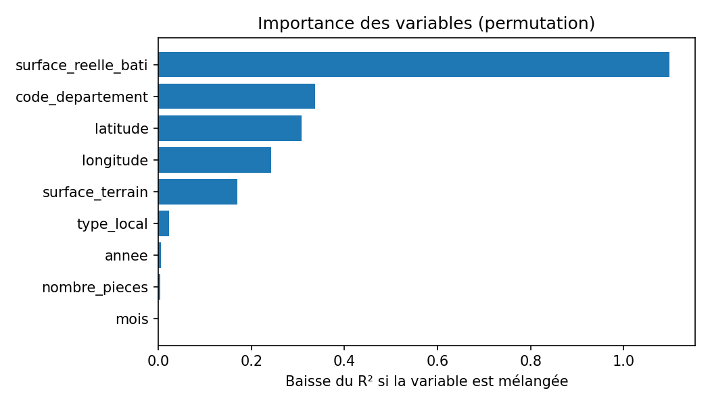

# 🏠 Analyse et prédiction des prix immobiliers en Île-de-France (DVF)

Projet data de bout en bout : de la donnée brute publique (DVF) à un dashboard Power BI
et un modèle de Machine Learning qui estime le prix d'un bien.

## Objectif

Répondre à deux questions :
1. **Comment évoluent les prix au m²** selon la commune, le département, le type de bien et le temps ?
2. **Peut-on estimer le prix d'un bien** (appartement ou maison) à partir de sa surface, son nombre de pièces, son terrain et sa localisation ?

## Aperçu du dashboard

### Page 1 — Marché


### Page 2 — Prix et évolution


### Page 3 — Carte et ventes


## Architecture

```
data.gouv.fr (DVF géolocalisées)
        │  01_download.py
        ▼
   data/raw/*.csv.gz
        │  02_clean.py        (nettoyage, filtres, prix au m²)
        ▼
   data/processed/ventes_propres.csv
        │  03_build_db.py     (modèle en étoile SQLite)
        ▼
   db/dvf.db ──────────┬──► dashboard/app.py ──► Dashboard web interactif
        │              │
        │              └──► exports/powerbi/*.csv (optionnel : Power BI)
        │  04_sql_analysis.py (requêtes SQL d'analyse)
        │  05_model.py        (Machine Learning)
        ▼
   exports/*.csv · reports/ · models/
```

**Modèle en étoile** : `fact_ventes` (prix, surface, pièces, terrain, coordonnées) reliée à
`dim_date`, `dim_localisation` et `dim_type_bien`.

## Technologies

Python (pandas, scikit-learn, matplotlib) · SQL (SQLite, fonctions de fenêtrage) · Power BI

## Lancer le projet

```bash
python -m venv .venv
# Windows : .venv\Scripts\activate    |  Mac/Linux : source .venv/bin/activate
pip install -r requirements.txt
python run_all.py
```

Chaque étape peut aussi être lancée seule : `python src/02_clean.py`, etc.
Si le téléchargement automatique échoue, télécharge les fichiers « DVF géolocalisées » sur
data.gouv.fr, place-les dans `data/raw/` (un fichier par département) puis lance
`python run_all.py --skip-download`.

## Nettoyage des données

Règles appliquées dans `02_clean.py` (les effectifs à chaque étape s'affichent dans la console) :
- ventes d'appartements et de maisons uniquement ;
- suppression des doublons dus aux parcelles multiples d'un même bien ;
- mutations à un seul bien (sinon le prix correspond à plusieurs biens) ;
- suppression des lignes incomplètes ;
- valeurs aberrantes écartées : prix entre 20 k€ et 5 M€, surface entre 9 et 400 m², 1 à 10 pièces, prix au m² entre 1 000 et 25 000 €.

## Résultats

> À compléter avec TES résultats après exécution (console, `reports/metrics.txt`).

- Nombre de ventes analysées : **[X]**
- Période : **[2022 – 2025]**
- Meilleur modèle : **[nom]**, RMSE **[X] €**, MAE **[X] €**, R² **[X]**, erreur relative médiane **[X] %**
- Variables les plus importantes : **[voir reports/figures/importance_variables.png]**




## Dashboard Power BI

1. Power BI Desktop → **Obtenir les données → Texte/CSV** et importer les 4 fichiers de `exports/powerbi/` :
   `fact_ventes.csv`, `dim_date.csv`, `dim_localisation.csv`, `dim_type_bien.csv`
   (optionnel : `predictions_test.csv`).
2. **Vue Modèle** : relier `fact_ventes[date_id]` → `dim_date[date_id]`,
   `fact_ventes[localisation_id]` → `dim_localisation[localisation_id]`,
   `fact_ventes[type_bien_id]` → `dim_type_bien[type_bien_id]` (plusieurs-à-un, filtre dans le sens dimension → fait).
3. Sélectionner `dim_date` → **Outils de table → Marquer comme table de dates** (colonne `date`, type Date).
4. Créer les mesures (DAX) :

```
Nb ventes = COUNTROWS(fact_ventes)
Prix m2 médian = MEDIAN(fact_ventes[prix_m2])
Prix moyen = AVERAGE(fact_ventes[valeur_fonciere])
Surface médiane = MEDIAN(fact_ventes[surface_reelle_bati])
Prix m2 médian N-1 = CALCULATE([Prix m2 médian], SAMEPERIODLASTYEAR(dim_date[date]))
Évolution annuelle % = DIVIDE([Prix m2 médian] - [Prix m2 médian N-1], [Prix m2 médian N-1])
```

5. Page 1, « Marché » : 4 cartes (Nb ventes, Prix m² médian, Prix moyen, Évolution annuelle %),
   courbe `dim_date[annee_mois]` × Prix m² médian (légende : type de bien),
   histogramme Prix m² médian par `code_departement`, segments (année, type de bien, département).
6. Page 2, « Carte » : carte avec `latitude`/`longitude` (taille = Nb ventes, couleur = Prix m² médian)
   ou carte de remplissage par commune, tableau des 20 communes les plus chères.
7. Page 3, « Prédiction » (optionnel) : `predictions_test.csv`, nuage de points prix réel / prix prédit,
   distribution de `erreur_pct`.

## Limites et pistes d'amélioration

- Les données DVF n'indiquent ni l'étage, ni l'état, ni le DPE : une partie du prix n'est pas explicable.
- Les mutations multi-biens sont exclues, ce qui retire une part des transactions.
- Découpage entraînement/test aléatoire : un découpage temporel serait plus proche d'un usage réel.
- Pistes : ajouter des données externes (transports, revenus INSEE), tester XGBoost/LightGBM,
  ajuster les hyperparamètres par validation croisée, déployer une petite application Streamlit.

## Source des données

Demandes de valeurs foncières (DVF) géolocalisées, data.gouv.fr (données ouvertes de l'État).
Vérifie les conditions de réutilisation sur la page du jeu de données.
